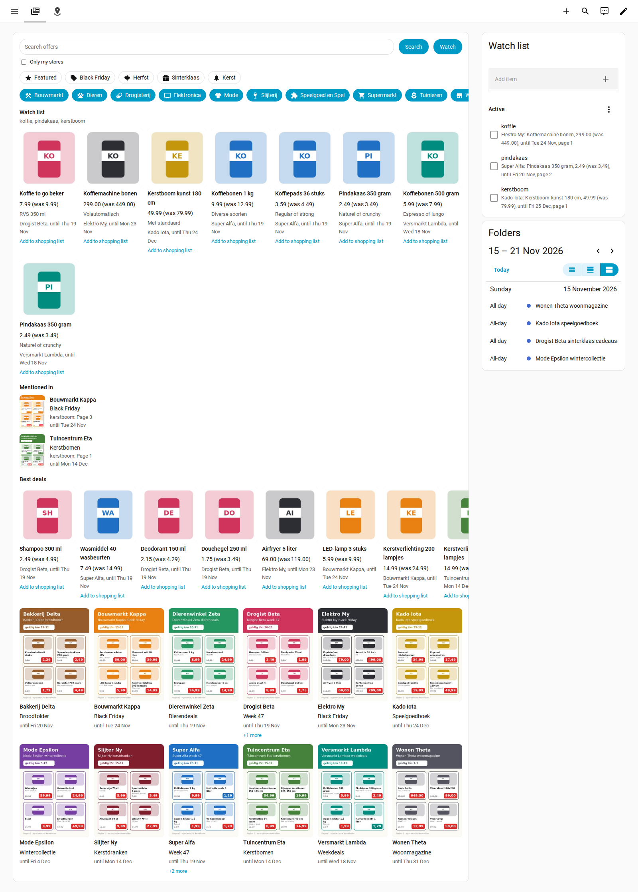
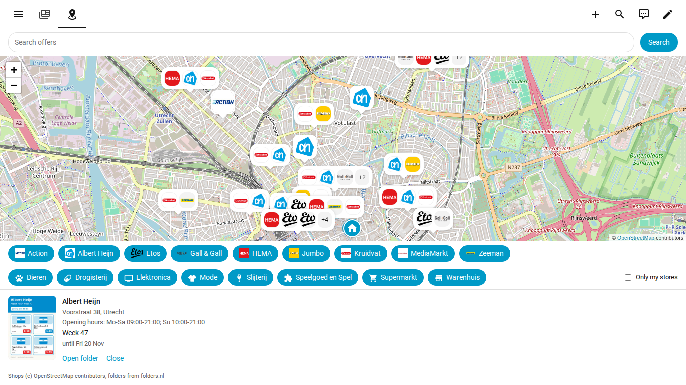
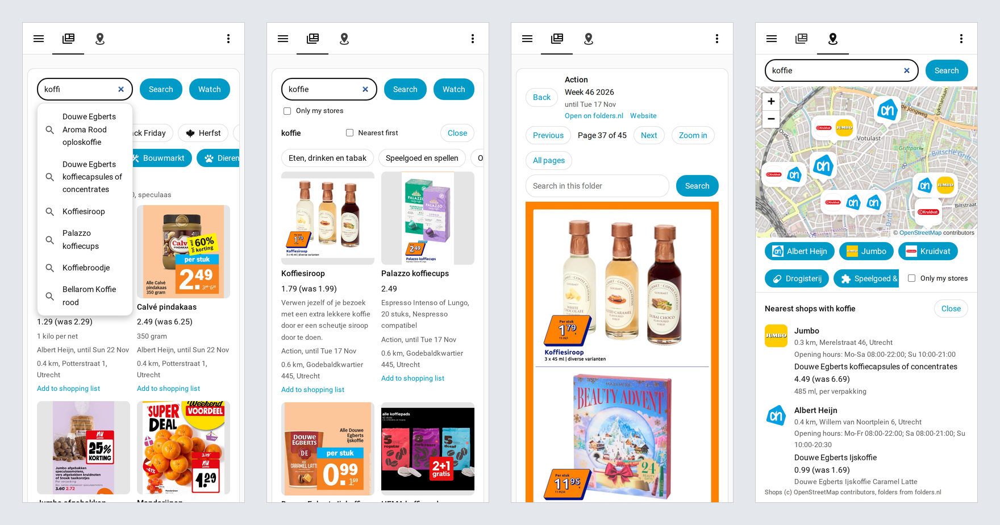

<p align="center">
  
</p>

<h1 align="center">Folders-HA</h1>

<p align="center">
  <strong>Folders for Home Assistant</strong><br>
  The folders of Dutch stores, the best deals, a product search, a watch list and a map of the shops, in Home Assistant.
</p>

<p align="center">
  <a href="https://github.com/Paulus1337/Folders-HA/releases"></a>
  <a href="https://hacs.xyz"></a>
  
  <a href="https://github.com/Paulus1337/Folders-HA/actions/workflows/validate.yml"></a>
  <a href="LICENSE"></a>
</p>

> [!IMPORTANT]
> **Unofficial open-source hobby project.** Folders-HA is made by volunteers in their spare time. It is not made, endorsed or supported by folders.nl, Publitas, WePublish or any store. It uses the same API as the folders.nl website, which can change at any time. Please do not contact folders.nl or the stores about it; use the [issue tracker](https://github.com/Paulus1337/Folders-HA/issues) instead.

## Features

- **Every store, your way**: Folders follows every store on folders.nl, also stores that join later. Leave out the categories, stores or themes you do not want, and keep single stores whose category you left out.
- **Folders inside Home Assistant**: read every folder page by page in the Folders card, with zoom, swiping, keyboard arrows, a grid of all pages, a search in the folder and the offers of each page. This works for every store, also the ones you do not follow.
- **Product search**: look up a product, such as *koffie*, in the offers of the current and coming folders, with their description and product category, and the folder pages and stores that mention it. Stores and products are suggested while you type. Each result shows the distance to the nearest shop of its store.
- **Nearest shops with the deal**: search on the map, and see the nearest shops of the stores that have the product, with their address, opening hours and the offer.
- **Best deals**: the biggest discounts of the stores you follow, in a sensor and on the dashboard, and the deals of a theme such as Black Friday.
- **Featured folders and themes**: the folders folders.nl shows first, and the folders of Black Friday, Sinterklaas, Christmas and other seasons, with one tap.
- **Watch list**: a to-do list of words to watch for, such as *koffie* or *luiers*, optionally with a price limit, such as *pindakaas < 2,50*. Each word shows its best current offer with the nearest shop that has it, or a folder that mentions it; the matching offers are counted in a sensor, and phone notifications tell you about the best new offer, with the distance and address of the nearest shop, and the first new mention of each word. Add words in the card, in the list or by voice.
- **Near you**: one tap in the card shows only the folders and deals of the stores with a shop near you (your phone's location, or your home).
- **Shopping list**: put an offer on your shopping list with one button.
- **Calendar**: when the folders of your stores start and end.
- **Map**: Home Assistant's own map, with the shops of the Netherlands that have a folder, their opening hours and their folder. Filter by store, with a row of the store logos in view under the map, by category or on your own stores. Scroll and zoom anywhere.
- **Picture entities**: the first page of the shown folder of every store you follow, for your own dashboards.
- **Notifications**: a ready-made blueprint for new offers on your watch list, folders that mention a watch word and new folders. Per word and update you get at most one notification for new offers, which shows the best new offer, the nearest shop that has it and how many more there are, and one for new mentions. Selecting the notification opens the folder in Home Assistant at the right page.
- **Actions for automations and voice assistants**: search the offers or get the best deals from a script.
- **Outages do not empty your dashboard**: when folders.nl cannot be reached, or suddenly answers far fewer stores or folders, Folders keeps showing the folders of its last good update for up to a day, and new and ended folders still come and go on time.
- **Privacy first**: Folders itself never sends a location, and your browser never contacts folders.nl. See [Privacy and security](#privacy-and-security).
- **English and Dutch**.

## Requirements

- Home Assistant 2025.8 or newer.
- No account is needed. folders.nl only covers stores in the Netherlands.

## Quick start

1. Add this repository (`https://github.com/Paulus1337/Folders-HA`) to the Marketplace or HACS and install **Folders**. Restart Home Assistant if it asks you to.
2. Go to **Settings > Devices & services > Add integration > Folders** and select **Submit**: Folders follows every store. You can leave out categories, stores or themes there or later.
3. Add the Folders card to a dashboard (see [The Folders card](#the-folders-card)), or use the [example dashboard](examples/dashboard.yaml).
4. Add some words to the watch list, and import the [notification blueprint](#notifications).
5. Optionally keep the picture entities out of the history: see [Entities](#entities).

## Installation

### Marketplace or HACS (recommended)

[](https://my.home-assistant.io/redirect/hacs_repository/?owner=Paulus1337&repository=Folders-HA&category=integration)

1. Click the button above. It opens the Marketplace (Home Assistant 2026.11 and newer) or HACS (older versions). You can also add `https://github.com/Paulus1337/Folders-HA` as a custom repository of type **Integration**.
2. Install **Folders**. Restart Home Assistant if it asks you to.

### Manual

1. Copy `custom_components/folders` into the `custom_components` folder of your Home Assistant configuration.
2. Restart Home Assistant.

## Setup and options

[](https://my.home-assistant.io/redirect/config_flow_start/?domain=folders)

1. Go to **Settings > Devices & services > Add integration > Folders**. Home Assistant loads the stores, categories and themes from folders.nl.
2. Folders follows every store. Leave out what you do not want (all fields are optional):
   - **Leave out categories**: a store is not followed when all its categories are left out. **Other stores** are the stores that folders.nl gives no category. A store in two categories stays followed while one of them is not left out.
   - **Leave out stores**: stores you never follow.
   - **Always follow these stores**: stores you follow even when all their categories are left out. A store cannot be left out and always followed at the same time.
   - **Leave out themes**: folders with one of these themes are left out everywhere: the folders view, the calendar, the picture entities, the notifications, the map, the search results and the deals.
3. Select **Submit**. Without any choice, Folders follows every store.

Folders can be added once. To change what you follow later, go to **Settings > Devices & services > Folders** and select **Configure** (the cogwheel). Saving reloads the integration. The options there also have **Watch all stores**: look for the words of the watch list in all stores, also the ones you do not follow.

| Option | Default | What it does |
| --- | --- | --- |
| Leave out categories | None | Do not follow stores whose categories are all left out. |
| Leave out stores | None | Never follow these stores. |
| Always follow these stores | None | Follow these stores even when all their categories are left out. |
| Leave out themes | None | Leave out folders with one of these themes, everywhere. |
| Watch all stores | Off | The watch list looks at all stores, not only the ones you follow. |

The stores you follow are recomputed with every update, so new stores and new categories are followed automatically. The stores you follow get the dashboard tiles, the best deals, the calendar, the new folder notifications and a picture entity each. The card's search, the map and the folder viewer cover all stores.

**Updating from 0.1**: Folders follows every store after the update, also when you followed only some stores before. Your stores of 0.1 become **Always follow these stores**, and your watch words move to the watch list. To follow fewer stores, select **Configure** and leave out categories or stores; for example, leave out every category except Supermarkt, and **Other stores** too, to follow only the supermarkets (and the stores you always follow). Automations on `event.folders_folders`, such as the new folder and new offer automations of the 0.1 README, now get events for every store you follow: leave out categories or stores first, add a store condition (and `max: 50` with `max_exceeded: silent`), or replace them with the [blueprint](#notifications) and its **Only these stores** input. `new_offer` now fires at most once per word and update, for the best fresh new offer, with the number of new offers in `new_offers` (see [Events](#events)).

## The Folders card

The integration makes the **Folders card** available on every dashboard. In the dashboard editor, select **Add card** and pick **Folders**, or add it in YAML.

```yaml
type: custom:folders-card
```

The folders view (the default) shows, from top to bottom:

- **Search**: type a product and press Enter or **Search**. **Only my stores** limits the results to the stores you follow. **Watch** adds the search text to the watch list, also with a [price limit](#price-limits) such as `pindakaas < 2,50`, which the watch list keeps as `pindakaas < 2.50`; a short note says that it was added, or why not, for example when it is already on the list. A search and the suggestions leave a price limit at the end of the text out, also one you are still typing, such as `pindakaas <`, so folders.nl only gets the words; the results show the words searched.
- **Suggestions**: while you type, after a short pause, a list opens under the search field with up to 3 stores that have a folder and whose name contains the text (names that start with it first), with their logo, and then up to 6 names of products that contain it, from the folders Home Assistant shows; case, accents, spaces and punctuation do not matter. The list only opens for 2 to 40 characters, and only when there is something to suggest. Select a store to open its folder in the folder viewer (**Back** returns to the search field), or a product to put its name in the search field and search for it; a name longer than the 40 characters a search takes is cut to 40 characters, at the end of a word when it can. The arrow keys move through the list, and Enter picks the selected row, or searches the text as typed when no row is selected. Escape or Tab closes the list and keeps the text; the list also closes when you leave the field, clear it or start a search.
- **Search results**: each result shows the product image, the title, the prices, the description (such as "500 gram"), the store and until when it is valid (or from when, for a folder that has not started yet), and the distance and address of the nearest shop of the store, such as "1.2 km, Voorstraat 38, Utrecht". Select a result to open the folder at its page. Around the results:
  - The header shows the search text, **Nearest first** (when distances are known), which orders the results by distance with results without a known distance last, and **Close**, which hides the results.
  - Store chips, with logo and name, show the stores with a folder that folders.nl finds for the search text; select one to open its folder.
  - Product category chips, when the results have two or more categories, show the results of one category at a time (**Other** for results without one); select the chip again to show all.
  - **Found in folders**, under the results, lists the folders whose pages mention the search text, with a thumbnail of the page, the store, the folder, the pages ("Page 20", or "Pages 3, 7, 12 +2") and the validity. Select one to open the folder at that page, with the search text as the search in the folder.
- **Themes**: a **Featured** chip for the folders folders.nl shows first, and a chip for each theme that has folders now, such as Black Friday or Sinterklaas. Select a theme to see only its folders and its deals, or **Featured** to see only the featured folders; select the chip again to go back.
- **Categories**: when the stores shown are in more than one category, chips to show only the folders, deals, matches and mentions of some categories. All are on to start with; **Other** is the stores without a category.
- **Near you**: the first chip of the category row, off to start with, labelled with its radius, such as "Near you, 5 km" (the `radius` option). Select it to show only the folders, best deals, watch matches and mentions of the stores with a shop within that distance, on top of the other chips; select it again to show everything. The search results stay as they are (they have **Nearest first**). Its tooltip says where it looks: "Around your location" is the location of your own person in Home Assistant (the person linked to your user), for example from the GPS of the Home Assistant app on your phone, and "Around home" is the home location of Home Assistant, used when your person has no location. The card never asks the browser for your location. While the chip is on, the card asks Home Assistant again every 30 minutes, when your location moves more than 200 meters and when it switches between your location and home. While Home Assistant downloads the shop list, the chip stays on, the card says "Loading the shops of the Netherlands, this takes a few minutes" and shows no folders, deals, matches or mentions yet, and it asks again every 15 seconds. When the shops are not available, the chip turns off again with the note "Shops are not available right now".
- **Watch list**: your watch words as the watch list keeps them (such as `koffie, pindakaas < 2.50`), the current offers that match them, each with the distance from your home and the address of the nearest shop of its store (such as "0.3 km, Voorstraat 38, Utrecht"; while **Near you** looks around your location, the distance from there instead, such as "0.2 km"), and **Mentioned in**: folders that mention a word without an offer for it, with a thumbnail of the page. Select one to open the folder at that page, with the word as the search in the folder.
- **Best deals**: the biggest discounts of the stores you follow, with product images.
- **Folders**: a tile for every store you follow that has a folder, with the first page, the store, the folder, until when it is valid (or from when, for a folder that has not started yet), "New" for folders of the last 3 days and "+2 more" when the store has more folders; select "+2 more" to list them.

Under a store name, the card shows a folder name without the store name it starts with: "Albert Heijn week 47 2026" shows as "Week 47 2026" under "Albert Heijn".

Select a tile, a deal, a search result, a match or a mention to open the folder in the **folder viewer**, inside the card: one page at a time, with the store, the folder, its validity and "Page 3 of 42", previous and next buttons, a zoom button, the arrow keys while the viewer has focus, and swiping. A page is at most 720 pixels wide, in the middle of the card; zoomed in, it is twice as wide (at most 1440 pixels), and you can scroll sideways when it does not fit. **All pages** shows a grid of small pages; select one to open it, and select **All pages** again to go back. **Search in this folder** finds the pages that mention a word (2 to 40 characters), shown as chips such as "p. 3" that open that page. Under the page, **On this page** lists the offers of that page with their product image, prices and description. **Back** (or Escape) returns to where you were. A small link opens the folder on folders.nl in a new tab, and a **Website** link opens the store's own website, when folders.nl knows it.

Every offer has an **Add to shopping list** button. It adds "title (store, price)" to your shopping list, `todo.shopping_list` by default. The buttons are hidden when that list does not exist.

The map is Home Assistant's own map, so it looks and behaves like every other map in Home Assistant, in light and dark mode. It starts at your home. Scroll and zoom anywhere in the Netherlands: from zoom level 11, the shops in view that have a current or coming folder appear with their store logo, at most 300 at a time, nearest to the centre first. Under the map, two rows of chips filter the shops. The first row has a chip for every store in view that the second row lets through, with its logo and name, sorted by name; the second row has a chip for every category of the stores in view, and **Only my stores**, which shows only the stores you follow. All chips are on to start with: select one to hide or show those shops. A row scrolls sideways when it does not fit, and the store row keeps its place when no store is in view, so the map keeps its size. The pointer turns into a hand over a shop; select it to see its address, its opening hours (as OpenStreetMap writes them), its folder and an **Open folder** button that opens the folder viewer in place of the map. The first time anyone opens the map, searches or selects **Near you**, or the watch list has words, Home Assistant downloads the shops of the whole country, which takes a few minutes; the map says so meanwhile.

The search bar above the map finds the **nearest shops with a product**: type a product and press Enter or **Search** (a price limit at the end of the text is left out, as in the folders view), or pick a product from the suggestions, which work as in the folders view (a store opens its folder in place of the map); **Only my stores** limits the search to the stores you follow. The map then shows only the shops of the stores that have it, and the panel lists the 10 nearest shops to the centre of the map, each with the store logo, the address, the distance, the opening hours and the store's first result (with "+2 more" when it has more). Select a shop to move the map to it and see all its results above the shop's details, each with **Open folder** at that page and **Add to shopping list**; its **Close** goes back to the list. **Close** in the list ends the search and shows all shops again. The search runs again every 30 minutes while it is open, so its images keep working.

```yaml
type: custom:folders-card
view: map
zoom: 14
```

| Option | Default | What it does |
| --- | --- | --- |
| `view` | `folders` | `folders` for the folders view, `map` for the map. |
| `zoom` | `14` | The zoom level the map starts at (1 to 20). Shops show from zoom level 11. |
| `shopping_list` | `todo.shopping_list` | The to-do list that **Add to shopping list** adds to. |
| `radius` | `5` | The distance in km (0.5 to 50) within which **Near you** looks for shops. |

The map works best in a panel view, which gives it the whole screen: the card keeps the height of the screen, and the list of nearest shops or the shop panel scrolls inside the lower half of the card. In a sections view it takes the full width and at least 10 rows. In other views the map is 300 pixels high, and the card grows with the list or the panel.

A link to a dashboard view with the Folders card can open a folder: add `?folders_folder=<folder id>` and optionally `&folders_page=<page>` and `&folders_query=<text>` (the search in the folder). The notification blueprint uses these links. The card removes them from the address once the folder is open.

If the card is missing right after installing or updating Folders-HA, reload the page or restart the Home Assistant app.

### Example dashboard

[`examples/dashboard.yaml`](examples/dashboard.yaml) is a dashboard with two views: **Folders** with the Folders card, the watch list and the calendar, and **Map** with the map in a panel view. The screenshots show real folders, offers, prices and store logos of 12 stores from folders.nl on 16 November 2026 and the OpenStreetMap shops of central Utrecht; the folders, logos and names belong to their stores.







1. Go to **Settings > Dashboards > Add dashboard > New dashboard from scratch**, name it **Folders** (so its address is `/dashboard-folders`, which the notification blueprint uses) and open it.
2. Select **Edit dashboard** (the pencil at the top, or in the three-dot menu on a narrow screen), then open the three-dot menu and select **Raw configuration editor**. Replace the text with the content of the file and save.
3. When Home Assistant is set to Dutch, use `todo.folders_volglijst` for the watch list.

## Watch list

The watch list is a to-do list: **Folders Watch list** (`todo.folders_watch_list`, or `todo.folders_volglijst` in Dutch). Each item is a word to watch for in the folders of the stores you follow (or of all stores with **Watch all stores**), such as `koffie`, `kaas` or `rode wijn`. Use Dutch product words: they are matched by the search of folders.nl.

- Add, rename, reorder and delete words in the To-do lists panel, in a To-do list card, with the **Watch** button of the Folders card or by voice with Assist, for example "Add koffie to the Folders Watch list". Words are 2 to 40 characters; case and extra spaces do not matter.
- Check a word off to pause it, and uncheck it to watch it again. At most 20 words are watched at a time; paused words do not count.
- Each word shows its best current offer, for example "Lidl: Koffiebonen 1 kg, 9.99 (was 12.99), until Sun 22 Nov, page 6, 0.3 km, Voorstraat 38, Utrecht" (in Dutch "..., t/m zo 22 nov, pagina 6, 0,3 km, Voorstraat 38, Utrecht"); the best offer is the one with the biggest discount. Without an offer, it shows a folder that mentions the word, for example "Mentioned in GAMMA Kerst 2026, page 28, until Thu 31 Dec", with the store in brackets when the folder name does not start with it, such as "Mentioned in Kerst (GAMMA)"; otherwise "No offer right now". This text follows the language of Home Assistant (English or Dutch) and cannot be edited. Home Assistant shows it as Markdown, so punctuation in the store, the title, the address and the folder gets a backslash (for example `Coca\-Cola`) that keeps it plain text; the To-do list card does not show the backslash.
- A change is searched 5 seconds after the last one.

**Mentions** are folders of the stores you watch whose pages mention a word while they have no offer for it, such as a DIY store's Christmas folder that mentions *kerstboom*. The card lists them under **Mentioned in**, at most 10 per word, by store and folder. Items with a price limit have no mentions.

The **Offers** sensor counts the current matches. The event entity tells about new ones, each kind at most once per word and update: `new_offer` with the best new offer of the word and the number of new offers, and `new_mention` with the first new mention and the number of new mentions. Only fresh news counts: offers of folders that started or appeared in the last 3 days, and mentions in folders that appeared in the last 3 days (see [Events](#events) and [Notifications](#notifications)). A word you add, rename or watch again after a pause only remembers the offers and mentions that exist at that moment; new ones that appear later fire, and a new offer that a word you already watched also finds still fires for that word.

### Price limits

A word can say what cheap means: end it with `<`, `max`, `under` or `onder` and a price, for example:

| You type | It watches |
| --- | --- |
| `pindakaas < 2,50` or `pindakaas <2.5` | `pindakaas < 2.50`: pindakaas for at most 2.50 |
| `koffiebonen max 9,99` | `koffiebonen < 9.99` |
| `luiers under 10` or `luiers onder 10` | `luiers < 10.00` |

- Case does not matter, the price may have a euro sign in front of it, and it is 0.01 to 9999 with a dot or a comma and at most two decimals. Another price gives a clear error. The words before the limit follow the rules of a word; text that does not end in such a price is an ordinary word, such as `max havelaar`.
- The watch list shows and keeps the item in one form: the words, " < " and the price with two decimals and a dot, such as `pindakaas < 2.50`.
- An item with a limit only matches offers whose shown price is at most the limit: the sale price, or the price when there is no sale price. Offers without a price never match it, and it has no mentions, because a mention has no price.
- Several items can watch the same words with other limits, or one without a limit, such as `pindakaas` and `pindakaas < 2.50`; they share one search at folders.nl. The same item twice is refused.
- Each match counts for the first item in the list that it matches, and shows that item's words and limit (see [Entities](#entities)).

### The nearest shop with the deal

Every match shows the distance from your home to the nearest shop of its store and the address of that shop, as the search results do: in the card, in the description of the word, in the **Offers** sensor, in the `new_offer` event and in the notification. They come from the national shop list of OpenStreetMap (see [How it works](#the-shop-list-and-distances)), which Home Assistant downloads as soon as the watch list has words; until it is there, or when the store has no shop in it, the distance is left out. While **Near you** in the card looks around your location, the card shows the distance from your location to the nearest shop of the store instead, without the address. Folders computes the distances inside Home Assistant: your home location itself never leaves it; the notifications name the shop and its distance (see [Privacy and security](#privacy-and-security)).

When two offers of a word have the same discount, the best one is the one with the nearest shop (stores without a known shop last), then by store and title.

## Best deals

Every 3 hours Folders asks folders.nl for the biggest discounts: the best 30 of each category you did not leave out, the best 50 of all stores while you follow **Other stores**, and the best 10 of each store you always follow outside your categories (at most 10 stores). It keeps those of the stores you follow with a current folder, once each, and orders them by sale price compared to the normal price. Prices are shown as folders.nl prints them; they can be multi-buy prices, so Folders never shows a discount percentage. The **Best deals** sensor counts them and lists the best 30; the card gets the best 60 and shows the best 30 of the categories you have on.

When you select a theme in the card, the best deals are the deals of that theme instead: the best 50 of the theme, of the stores you follow with a current folder. Home Assistant asks folders.nl for them at most once per theme every 10 minutes; when that fails, the card shows the normal best deals.

## Calendar

**Folders** (`calendar.folders_folders`) has one event for every current and coming folder of the stores you follow, from the first to the last day of the folder, named after the folder, such as "Albert Heijn week 47 2026", with the store in front when the folder name does not start with it, such as "Lidl: Kerst", and with the link to the folder on folders.nl. Add it to a Calendar card to see which folders start next week.

## Actions

Two actions answer with data, for scripts, automations and voice assistants. You can try them in **Settings > Tools > Actions** (on Home Assistant 2026.2 to 2026.7: **Settings > Developer tools > Actions**; on older versions: **Developer tools > Actions** in the sidebar).

```yaml
action: folders.search
data:
  query: koffie
  scope: all
  limit: 10
response_variable: found
```

`folders.search` searches the offers and the folder pages of the current and coming folders: `query` (2 to 40 characters), `scope` (`all` or `followed`, default `all`) and `limit` (1 to 60, default 10). The answer has:

- `results`: each with `offer_id`, `title`, `price`, `sale_price`, `description`, `product_category`, `store_id`, `store`, `folder_id`, `folder`, `page`, `valid_from`, `valid_until`, `upcoming`, `followed`, `distance` (km from your home to the nearest shop of the store, or `null`) and `address` (of that shop, or `null`), followed stores first;
- `more`: true when there are more results;
- `folders`: up to 30 folders whose pages mention the text, each with `folder_id`, `store_id`, `store`, `folder`, `pages`, `valid_from`, `valid_until`, `upcoming`, `followed` and `url`, followed stores first.

```yaml
action: folders.best_deals
data:
  limit: 5
  category: supermarkt
response_variable: deals
```

`folders.best_deals` answers with `deals`, the best deals of the Best deals sensor (`limit` 1 to 30, default 10), each with `store`, `title`, `price`, `sale_price`, `valid_until`, `folder_id`, `page`, `url` and `offer_id`. `category` (a category slug such as `supermarkt`) keeps only the deals of stores in that category, and `theme` (a theme slug such as `black-friday`) gives the deals of that theme instead. An unknown slug gives a clear error.

Both actions fail with a clear message when Folders is not loaded or folders.nl cannot be reached.

## Notifications

A phone notification for new offers on your watch list, for folders that mention a watch word and for new folders of the stores you follow. Selecting the notification opens the folder in Home Assistant at the page of the offer or the mention.

[](https://my.home-assistant.io/redirect/blueprint_import/?blueprint_url=https%3A%2F%2Fraw.githubusercontent.com%2FPaulus1337%2FFolders-HA%2Fmain%2Fblueprints%2Fautomation%2Ffolders%2Fnotify.yaml)

1. Click the button above and select **Preview** and **Import blueprint**. You can also import `https://github.com/Paulus1337/Folders-HA/blob/main/blueprints/automation/folders/notify.yaml` in **Settings > Automations & scenes > Blueprints > Import blueprint**.
2. Select the blueprint **Folders: notify me** to create an automation, and choose the Folders event entity and your phone (the phone needs the Home Assistant app).
3. Choose what you want a notification for: new offers on the watch list (the default), folders that mention a watch word, new folders of the stores you follow, or more of them. With every store followed, folders.nl brings about 100 new folders a week, so new folders are best limited with **Only these stores**.
4. Optionally limit new offers and mentions to some words of the watch list (**Only these words**, separated by commas, without the price limit of an item: `pindakaas` for `pindakaas < 2.50`, which also covers `pindakaas` without a limit) and new folders to some stores (**Only these stores**, store names separated by commas, case does not matter), and set the path of the dashboard view with the Folders card (default `/dashboard-folders/folders`, the Folders view of the example dashboard).
5. Save.

A word gets at most one notification per update for its new offers, and one for its new mentions. A new offer names the distance from your home to the nearest shop of its store and the address of that shop, when they are known. A word with several new offers gets one notification for the best of them (the biggest discount), for example "Koffiebonen 1 kg, 9.99 (was 12.99), 0.3 km, Voorstraat 38, Utrecht and 2 more"; a word with several new mentions gets one for the first by store and folder, for example "kerstboom on page 28 of GAMMA Kerst 2026 and 1 more". The **Offers** sensor counts every current match, and the card shows the matches and mentions of every word. Only fresh news is sent, so a broad word does not bring old offers: see [Events](#events).

An offer opens the folder at the page of the offer. A mention opens the folder at the first page that mentions the word, with the word as the search in the folder.

If you prefer to write the automation yourself, this is the same for new offers only. Go to **Settings > Automations & scenes > Create automation > Create new automation**, open the three-dot menu, select **Edit in YAML**, replace the text with this and save:

```yaml
alias: "Folders: new offer"
mode: queued
max: 50
max_exceeded: silent
triggers:
  - trigger: state
    entity_id: event.folders_folders
conditions:
  - "{{ trigger.from_state and trigger.to_state and 'unavailable' not in (trigger.from_state.state, trigger.to_state.state) }}"
  - "{{ trigger.from_state.state != trigger.to_state.state or (trigger.from_state.attributes.items() | rejectattr('0', 'in', ['friendly_name', 'icon', 'entity_picture']) | list) != (trigger.to_state.attributes.items() | rejectattr('0', 'in', ['friendly_name', 'icon', 'entity_picture']) | list) }}"
  - "{{ trigger.to_state.attributes.event_type == 'new_offer' }}"
actions:
  - action: notify.mobile_app_your_phone
    data:
      title: "New offer: {{ trigger.to_state.attributes.store }}"
      message: "{{ trigger.to_state.attributes.title }}, {{ trigger.to_state.attributes.distance }} km and {{ trigger.to_state.attributes.new_offers - 1 }} more"
      data:
        url: "/dashboard-folders/folders?folders_folder={{ trigger.to_state.attributes.folder_id }}&folders_page={{ trigger.to_state.attributes.get('page') or 1 }}"
        clickAction: "/dashboard-folders/folders?folders_folder={{ trigger.to_state.attributes.folder_id }}&folders_page={{ trigger.to_state.attributes.get('page') or 1 }}"
```

- Replace `notify.mobile_app_your_phone` with the notify action of your own phone. Do not use `notify.notify`: it sends to every phone with the Home Assistant app.
- `new_offers` is the number of new offers of the word in this update, the one in the notification included. `distance` is the distance in km from your home to the nearest shop of the store (`null` while the shop list is not there, or when the store has no shop in it), and `address` the address of that shop.
- For new folders, use `new_folder` in the last condition, and `folder`, `valid_from` and `valid_until` in the message. For mentions, use `new_mention`, and `word`, `folder`, `page` and `new_mentions` (the number of new mentions of the word) in the message; add `&folders_query={{ trigger.to_state.attributes.word | urlencode }}` to the links to search the word in the folder.
- Keep the first two conditions, `mode: queued` and `max_exceeded: silent`: one update can bring several events, a restart briefly makes the event entity unavailable, and renaming the event entity or changing its icon must not send the last event again.
- The new offers of a word come in one notification per update, and so do its new mentions, but new folders come one by one: one update sends at most 50 notifications, for example when the new weekly folders of many stores come at once. The **Offers** sensor always counts every match.
- The link opens the dashboard view with the Folders card; the card opens the folder at that page. Any dashboard view with a Folders card works: change `/dashboard-folders/folders` to its path.

## Entities

The integration creates one **Folders** service device with these entities.

| Entity ID | Dutch entity ID | Description |
| --- | --- | --- |
| `image.folders_<store>` | the same | One for every store you follow that has a current or coming folder, for example `image.folders_albert_heijn`; a store that gets its first folder later gets its entity then. The first page of the shown folder; unavailable while the store has no folder, so a store you follow keeps its entity (with its name, area and settings) between two folders. The entity of a store that leaves folders.nl, or that you no longer follow, is removed at the next good update, never during an outage. Attributes: `store`, `folder`, `valid_from`, `valid_until`, `upcoming` (true when the folder has not started yet), `url` (the folder on folders.nl), `store_url` and `other_folders` (up to 5 other current or coming folders, each with `name`, `valid_from`, `valid_until` and `url`). The state is the time Home Assistant last saw the shown folder change. It also changes when Home Assistant starts or the integration reloads, so use `event.folders_folders` for notifications. |
| `sensor.folders_offers` | `sensor.folders_aanbiedingen` | The number of current offers that match a word of the watch list. Attributes: `words` (the items being watched, as the watch list shows them, such as `koffie` or `pindakaas < 2.50`) and `offers` (up to 50, sorted by store and title, each with `store`, `title`, `price`, `sale_price`, `valid_until`, `folder_id`, `page`, `url`, `description`, `limit` (the price limit of the item it matches, or `null`), `distance` (km from your home to the nearest shop of the store, or `null`) and `address` (of that shop, or `null`)). |
| `sensor.folders_best_deals` | `sensor.folders_beste_aanbiedingen` | The number of best deals. Attribute `deals`: the best 30, each with `store`, `title`, `price`, `sale_price`, `valid_until`, `folder_id`, `page` and `url`. |
| `event.folders_folders` | `event.folders_folders` | Fires `new_folder` for every new folder of a store you follow, with `store`, `folder`, `valid_from`, `valid_until`, `url` and `folder_id`. Per word of the watch list and update, at most one `new_offer`, for the best new offer, with `store`, `title`, `price`, `sale_price`, `description`, `word` (the words of the item, without its price limit), `limit` (the price limit, or `null`), `url`, `folder_id`, `page`, `distance` and `address` (of the nearest shop of the store, or `null`) and `new_offers` (the number of new offers of the word, this one included), and at most one `new_mention`, for the first new mention, with `store`, `folder`, `word`, `folder_id`, `page` (the first page that mentions the word), `url`, `valid_from`, `valid_until` and `new_mentions` (the number of new mentions of the word). See [Events](#events). |
| `calendar.folders_folders` | `calendar.folders_folders` | The current and coming folders of the stores you follow. |
| `todo.folders_watch_list` | `todo.folders_volglijst` | The watch list. The state is the number of words being watched. Each item is a word, or a word with a price limit such as `pindakaas < 2.50`. |

The shown folder of a store is the current folder that started last; when no folder is current, the next one. A price of `null` means folders.nl gives no price. `page` is the page number in the folder, counted from 1.

Home Assistant creates the entity IDs once, in its own language (**Settings > System > General**): Dutch IDs when Home Assistant is set to Dutch, English IDs in every other language. Use your own entity IDs wherever this README shows one.

**Picture entities and the history**: with every store followed there are about 135 picture entities. Home Assistant renews the access token of every picture entity every 5 minutes, which writes a new state each time: about 1,600 rows an hour in the history database. The card does not need the picture entities. To keep them out of the history, add this to `configuration.yaml` (or to its `recorder:` section if it already has one) and restart Home Assistant:

```yaml
recorder:
  exclude:
    entity_globs:
      - image.folders_*
```

You can also disable the picture entities you do not need in **Settings > Devices & services > Folders > entities**; a disabled entity stays disabled after updates.

## Privacy and security

- **Folders never sends a location.** Not to folders.nl, not to the OpenStreetMap Overpass API. Your home location is only used inside Home Assistant, to compute the distance to the nearest shops of the search results and the watch list; the map search uses the centre of the map in the same way. **Near you** uses the location of your own person in Home Assistant (for example the GPS of the Home Assistant app on your phone): the card sends it only to Home Assistant, which uses it there to find the stores with a shop nearby. When your person has no location, the card sends none and Home Assistant uses your home location. The card never asks your browser for its location.
- **Notifications**: the new offer notification of the blueprint names the nearest shop of the store and its distance from your home, which tells roughly where you live. Like every phone notification of Home Assistant, it goes through the push service of the Home Assistant app (Google or Apple) when the app has no direct connection to Home Assistant.
- **folders.nl only gets general questions**: the lists of stores, categories and themes, all current and coming folders, the featured folders, the best deals per category or store, the deals of a theme you select, and per word of the watch list its offers, their descriptions and the folder pages that mention it. When you search in the card or with the `folders.search` action, that text goes to folders.nl as a search term, just like your watch words; while the results stay open in the card, it is asked again every 30 minutes. While you type in the search field of the folders view or of the map, after a short pause, the text so far goes to folders.nl as a search term too, to find product suggestions; the store suggestions come from Home Assistant itself. The search in a folder makes no suggestions. When you open a folder, Home Assistant asks folders.nl for its pages, offers and descriptions, and when you search in a folder, for the text of its pages. There is no account and no sign-in.
- **All images come through Home Assistant.** The folder pages and their thumbnails, covers, store logos and product images are downloaded by Home Assistant from the WePublish image hosts of folders.nl and served to your browser by Home Assistant itself, with paths signed for one hour. Your browser never contacts folders.nl. Links to folders.nl and to store websites only open when you select them, in a new tab without a referrer, and only `https` store websites are used.
- **The OpenStreetMap Overpass API only gets the store names.** The map and the distances need the shops of the stores, and Home Assistant gets them in one download for the whole country: the question names all folders.nl stores and the Netherlands, never a place. This only happens when the map, a search or **Near you** needs them, or when the watch list has words (so its offers and notifications can name the nearest shop): the first time, and after that when the list is older than 14 days (after a failed download, an hour later at the earliest).
- **Map tiles**: the map is Home Assistant's own map. It starts at your home and loads the tiles of the area on screen from its map provider: newer versions of Home Assistant get them through Home Assistant itself from the OpenStreetMap tile servers, older versions load them directly in your browser from CARTO. That provider sees which area you look at, as with every map in Home Assistant.
- **Nothing personal is stored.** The Folders entry keeps what you left out and always follow. The watch list is kept in `.storage/folders.watch_list`. The shop list in `.storage/folders.shops` is public OpenStreetMap data with the time of the download. The `other_folders`, `offers` and `deals` attributes are left out of the history.
- **Safe diagnostics.** The Folders part of the diagnostics only contains counts: left out categories, stores and themes, always followed stores, followed stores, watched and paused words, stores, folders, featured folders, offers, mentions, deals, picture entities and shops, the age of the shop list, whether the last update worked, the age of the last update Folders trusted and whether updates fail now. Never the words, categories, themes or store names. Home Assistant adds its own details, such as its version and the list of installed custom integrations, so look the file over before you share it.
- **No extra packages.** The integration only uses libraries that come with Home Assistant. Requests to folders.nl use Home Assistant's own connection, whose user agent names Home Assistant. The OpenStreetMap download names this integration instead (`Folders-HA` with a link to this page), because the OpenStreetMap server refuses general programming library names.

Anyone who can open your Home Assistant can see the Folders entities, use the card, search, and change the watch list. To report a security problem, see the [security policy](SECURITY.md).

## Known limitations

- Shops come from OpenStreetMap, which volunteers keep up to date. Shops can be missing, closed or in the wrong place, and opening hours can be missing or outdated. Distances are straight lines, not travel distances.
- Shops are matched to stores by name: the brand of a shop in OpenStreetMap, or else its name, must be the name of the store on folders.nl (case, accents, spaces and punctuation do not matter). Shops with another name do not show, and a shop with the same name as a store can show by mistake.
- folders.nl gives offers a title and prices as printed, but no discount percentages. The best deals are ordered by sale price compared to the normal price, which can be off for multi-buy prices.
- Descriptions and product categories come with searches, watch words and opened folders; the best deals and theme deals have none.
- Only Dutch stores. folders.nl has no folders for other countries.
- The first map load, search, **Near you** or watch word takes a few minutes to get the shops of the whole country; until then the results and the watch list have no distances; the watch list gets them as soon as the download ends.
- During an outage of folders.nl, Folders shows the folders of its last good update for up to 24 hours. It keeps them in memory only: after a restart during an outage, the folders come back when folders.nl answers again.
- The public OpenStreetMap server is sometimes busy. Home Assistant then tries twice more, and after that again after an hour at the earliest.
- The map shows at most 300 shops at a time and only shops of stores that have a current or coming folder.
- A search shows at most 60 results and 30 folders that mention the text. Folders shows at most 400 pages of a folder. A search in a folder works only for folders whose text folders.nl has.
- Which folders, offers and mentions were already seen is not kept over restarts. After a restart, reload or options change, the first update only remembers what exists, so nothing fires for what appeared meanwhile, and the folders that are there count as old: of those, only new offers in the first 3 days after the folder started can still fire.
- The events only tell about fresh news. folders.nl answers at most 300 offers of a word and only a part of the folders that mention it, so for a broad word an older offer or mention can show up in a later answer, and then it never fires. A folder whose offers of a word drop out of the answer never fires as a mention of that word either.
- Repositories added from a link are checked for updates by the Marketplace every 48 hours, and only when Home Assistant is connected to GitHub.

## Troubleshooting

- **"Could not reach folders.nl" during setup**: check that Home Assistant has internet access and try again later. Submitting the form again tries again.
- **"A store cannot be left out and always followed at the same time"**: take the store out of one of the two lists.
- **The card says "The folders are not available right now"**: the Folders entry is not loaded; check it in **Settings > Devices & services**. The card tries again every 30 seconds.
- **The card says "No folders right now"**: none of the stores you follow has a current or coming folder. Check which stores and categories you left out in **Settings > Devices & services > Folders > Configure**.
- **The log says "folders.nl does not answer as expected (...), showing the folders of ..."**: folders.nl could not be reached, sent an error, or sent an empty list or less than half of the stores or folders it had before. Folders keeps showing the folders of that time, with the folders that end dropping out and coming ones starting on time, and tries again every 15 minutes; the log says "folders.nl answers again" when it is back. After 24 hours the Folders entities become unavailable (except the watch list and the event entity) until folders.nl answers. When folders.nl really has far fewer stores or folders, Folders shows them once the same answer has come back for 6 hours.
- **A watch word has no text on the watch list**: the word is paused, or folders.nl has not answered its search yet: a new word is searched 5 seconds after the change, and folders.nl sometimes answers the search of a text with an error. The word gets its text once folders.nl answers it; the other words keep updating meanwhile (see [Updates and outages](#updates-and-outages)).
- **Near you turns off again with "Shops are not available right now"**: the shop list is not available (see the map messages below), or the Folders entry is not loaded. Select the chip again later.
- **Near you says "Around home" while your phone has a location**: the chip uses the person linked to your Home Assistant user (**Settings > People**), and only when that person has a location, for example from a phone with the Home Assistant app that is set as one of its tracked devices.
- **"Searching is not possible right now"**: folders.nl did not answer the search, or the Folders entry is not loaded. Try again later.
- **Search results or watch matches have no distance**: the shop list is not there yet (the first search, or the first update with watch words, starts the download, which takes a few minutes; the watch list gets the distances as soon as it ends), or the store has no shops in OpenStreetMap.
- **"Use a price limit from 0.01 to 9999 with at most two decimals"**: a word ends with `<`, `max`, `under` or `onder` and a number that is not a price Folders can use, such as `2,505` or `10000`. See [Price limits](#price-limits).
- **The viewer says "This folder is no longer available"**: the folder has ended, for example when you open an older notification, or its theme is left out.
- **The viewer says "The folder could not be loaded right now"**: folders.nl did not answer; try again later. When folders.nl has no page images for a folder, it can only be read on folders.nl: use the **Open on folders.nl** link at the top of the viewer, under the store and folder name, next to **Back**.
- **The viewer says "Searching in this folder is not possible right now"**: folders.nl has no text for some folders, so they can only be read page by page; otherwise folders.nl did not answer, so try again later. "No matches in this folder." means the text of the folder does not have the word.
- **The map says "Loading the shops of the Netherlands"**: the first download takes a few minutes. The card asks again every 15 seconds.
- **The map says "Shops are not available right now"**: the download failed, usually because the public OpenStreetMap server is busy. Home Assistant tries again an hour later, when the map, a search, **Near you** or an update with watch words asks for shops. The log says what happened.
- **The map says "Zoom in to see the shops"**: shops show from zoom level 11, in a view of at most 1.5 degrees.
- **The map says "The map could not be loaded"**: reload the page. The card uses the map of Home Assistant itself, which loads with it.
- **The list of nearest shops makes the page scroll**: put the map card in a panel view, as in the example dashboard, or in a sections view. There the card keeps its height and the list scrolls inside it; in other views the card grows with the list.
- **"The watch list watches at most 20 words at a time"**: check off or delete a word first.
- **A notification opens the dashboard but no folder**: the dashboard path in the blueprint must be a view with a Folders card.
- **No notification for an offer that the card shows**: a word gets one notification per update, for its best new offer, with "and 2 more" for the others. Only fresh offers are sent: of a folder that started, or that Folders first saw, in the last 3 days. Offers of folders that were there when Home Assistant started, and that started more than 3 days ago, are never sent. See [Events](#events).
- **The history database grows quickly**: keep the picture entities out of the history, see [Entities](#entities).
- **Debug logging**: add the following to `configuration.yaml`, or to its `logger:` section if it already has one.

  ```yaml
  logger:
    logs:
      custom_components.folders: debug
  ```

## Removal

1. Remove the Folders card from your dashboards, and delete a dashboard made from the example in **Settings > Dashboards**; without the integration they show errors. Delete automations made from the blueprint.
2. Delete the Folders entry in **Settings > Devices & services**. This also deletes the stored shop list and the watch list.
3. Remove the integration in the Marketplace or HACS, or delete `custom_components/folders`. Delete the blueprint in **Settings > Automations & scenes > Blueprints** if you imported it. Remove the `recorder:` exclude of `image.folders_*` if you added it.
4. Restart Home Assistant.

## How it works

This section documents the design, so the code itself can stay small.

### folders.nl

Home Assistant asks folders.nl through the GraphQL API its website uses (`api.wepublish.digital`), always as plain GET requests that wait at most 30 seconds:

- **Once a day**: the stores (pages of 100, about 4 requests), the categories (1) and the themes (1), and once more at the second update after a start, a reload or a change of the options (see [Updates and outages](#updates-and-outages)). A store list without any store counts as a failed update.
- **Every 3 hours**: all current and coming folders of all stores (pages of 100, about 4 requests; the map and the search need every store), the featured folders (1; when that fails, the last ones stay), the best deals (17 requests with nothing left out: one per category, one for all stores, and one per store you always follow outside your categories) and per word of the watch list its offers with their descriptions and the folder pages that mention it (3 requests, up to 8 for words with many offers; items with the same words, such as `pindakaas` and `pindakaas < 2.50`, share one search). After a failed update, the next try is 15 minutes later instead of 3 hours (see [Updates and outages](#updates-and-outages)). A change of the watch list updates 5 seconds after the last change.
- **When you search**: the offers (pages of 100, at most 3), the descriptions of each page of offers, and the folder pages and stores that mention the text: 3 to 8 requests. When folders.nl cannot answer the folder pages for a text, Home Assistant asks once more for fewer of them; when that fails too, the search shows only the offers. The answer is used again for 10 minutes.
- **While you type a search**: after each pause of 300 milliseconds, 1 request for the product suggestions of the text so far (2 to 40 characters): one page of 30 offers with their folder, of which Home Assistant shows up to 6 product names that contain the text and come from the folders it shows. The card waits for that answer before it asks again: the text of a pause in the meantime is asked when the answer comes, if it is still in the field, so a search or a folder never waits behind suggestions you no longer see. The answer is used again for 10 minutes; when there is no answer within 5 seconds (the wait for its turn included), there are no product suggestions. A text without a letter from a to z or a digit, such as "!!", makes no request. The store suggestions come from the data Home Assistant already has, without a request.
- **When you open a folder**: 2 to 5 requests, for its page count, its offers and their descriptions. They are used again for 6 hours.
- **When you search in a folder**: 1 request for the text of all its pages, used again for 6 hours, for the last 20 folders.
- **When you select a theme**: 1 request for its deals, used again for 10 minutes.

At most 2 searches, suggestions, folders, folder texts or theme deals are asked at the same time. Home Assistant keeps the last 100 searches, the suggestions of the last 100 texts and the last 100 folders in memory, so the pages of an open folder keep working. Offers that appear twice are shown once. Only offers whose folder is current are counted, and only folders.nl links, `https` store websites and `https` images from the WePublish hosts are used.

### Updates and outages

Every good update follows folders.nl: new folders show up everywhere (the tiles, the calendar, the events and the picture entity of a store that gets its first folder), and folders that ended or were withdrawn disappear. Folders only trusts an update when the store list and the folder list are not empty and not shorter than half of the last trusted ones (once those had at least 20 stores or folders). An update that fails, because folders.nl cannot be reached, sends an error or fails this check, keeps the answers of the last trusted update and builds the data again from them with the current time: folders and offers that ended drop out, coming folders start (their offers count and can fire as new), and each store moves on to its next folder. The entities stay available, the picture entities of stores that left folders.nl or that you no longer follow are only removed after a trusted update, and the event entity sees nothing new, so nothing fires again afterwards. The next try is 15 minutes later; a trusted update goes back to every 3 hours. Folders shows the folders of the last trusted update for up to 24 hours; after that the update fails as usual and the entities become unavailable, except the watch list and the event entity. When folders.nl answers the same kind of short list for 6 hours in a row, Folders takes it as real, so a real big change still arrives. The log gets one warning when an outage or a failed check starts, and one info line when trusted data is back.

The first update after a start, a reload or a change of the options has no trusted update to compare with, so it only rejects empty lists; it reads the store list again at the next update instead of a day later, so a store list that folders.nl happened to cut short at that moment is replaced within 3 hours, and the picture entities of the missing stores come back with their name, area and settings.

folders.nl sometimes answers the search of a text with an error. That does not fail the update: such a word keeps the offers of its last answer, or has no offers and no text on the watch list until folders.nl answers it, while the other words, the folders and the deals keep updating. A word that has not answered yet remembers its offers when it first answers, so they do not fire as new then.

### Following

The stores you follow are every store on folders.nl, minus the stores you leave out, minus the stores whose categories are all left out (a store without a category counts as **Other stores**) unless you always follow them. Folders with a left out theme are dropped before anything else, so they are nowhere: not in the folders view, the featured folders, the calendar, the picture entities, the events, the search results, the suggestions, the deals, the watch list or the map (a store without other folders has no shops on the map).

### Images

Home Assistant serves all images at `/api/folders/image/...` with paths signed for one hour, and only accepts JPEG, PNG, WebP and GIF, recognised by the image itself. The address of an image always comes from the folders.nl data, never from the browser. Logos, covers, page thumbnails and product images (at most 2 MB each) are kept in memory for 6 hours, at most 200 images and 20 MB; folder pages (at most 4 MB each) are not kept. Page thumbnails exist for the pages of an opened folder, and up to page 400 of a folder that was not opened yet. Product images are found by their offer, from the last 5000 offers Home Assistant read or showed in the card.

### The shop list and distances

The first time the map, a search or **Near you** needs shops, or an update finds words on the watch list, Home Assistant downloads the shops of all folders.nl stores in the Netherlands from the public OpenStreetMap Overpass API in one request, which takes about two minutes and is about 4 MB. A busy server is asked again after 30 and after 90 seconds. An answer without any shop of a folders.nl store counts as a failed download. Home Assistant keeps the shops (an id, the place rounded to about a metre, the store, the street, the house number, the town and the opening hours) in `.storage/folders.shops`, so a restart does not download them again. After 14 days the list is downloaded again in the background while the old one keeps serving; a list from 0.1, without opening hours, is downloaded again the first time it is needed. After a failed download, the next try is an hour later at the earliest.

Distances are computed in Home Assistant, along the surface of the earth, from your home location (for search results and watch matches), the centre of the map (for the map search) or the location the card sends (for **Near you**) to the nearest shop of each store, in km with one decimal. The watch matches get their distances at every update, from the shop list Home Assistant has at that moment. While **Near you** looks around your location, the card shows the distances of its answer on the watch matches instead, without the address.

**Near you** asks Home Assistant for the stores with a folder that have a shop within the radius of a point (the location of your person, or else your home), with the distance of their nearest shop; Home Assistant answers from the stored shop list, without any request to the internet.

### The folders view

The folders view asks Home Assistant for its data when it opens, every 30 minutes (the image paths are signed for one hour) and 2 seconds after one of the Folders entities changes. Home Assistant answers from its last update, without a request to folders.nl; only a search, the product suggestions while you type, a theme's deals, opening a folder and a search in a folder ask folders.nl, as described above. Search results that stay open for 30 minutes are searched again at one of these moments, so their images keep working. While **Near you** is on, the card asks Home Assistant for the stores near you when you select it, every 30 minutes, every 15 seconds while the shop list loads, and when your location moves more than 200 meters; Home Assistant answers from the stored shop list. The folder viewer shows one page at a time and loads the next one ahead.

### The map

The Folders card checks once per second which part of the map is in view, while the page is visible. When the view stops changing, it asks Home Assistant for the shops in that box, and Home Assistant answers from the stored list, without any request to the internet. The logos and covers come with signed paths, so the card asks again every 30 minutes. The map search asks for the nearest shops of the stores in the results the same way.

### Events

`event.folders_folders` fires for what appears after the entry was loaded. Within one update it fires:

1. `new_folder` once for every new folder of a store you follow, in the order of their start. Folders of next week often appear a few days early, and fire then.
2. Then, for each word of the watch list in the order of the list, at most one `new_offer` and then at most one `new_mention`.

An offer is new when it was not seen before, also not under another id (folders.nl sometimes answers one offer twice, under two ids with the same store, title, prices and page), its folder has not ended, a word that was searched in the update before finds it, and it is fresh: its folder started in the last 3 days, or Folders first saw the folder in the last 3 days. So the offers of next week's folder fire when it starts. An offer that several words find counts for the first of them in the list that was searched in the update before, and the event carries the words of that item as `word` and its price limit as `limit`. `new_offer` carries the best new offer of the word, the one with the lowest sale price compared to its price (then the nearest shop, then by store and title), the distance and address of the nearest shop of its store, and `new_offers`, the number of new offers of the word.

A mention is new when it was not seen before, the folder pages of its word were read in the update before, Folders first saw its folder in the last 3 days, and no answer of folders.nl since the entry was loaded had an offer of the word in that folder. `new_mention` carries the first new mention of the word by store and folder name, and `new_mentions`, the number of new mentions of the word.

The folders that are there when the entry is loaded count as old, so a restart never makes them fresh. Every new offer and mention is remembered, also the ones that do not fire, so none of them fires later: folders.nl answers at most 300 offers of a word and only a part of the folders that mention it, so for a broad word such as *koffie* older offers and folders can show up in a later answer. For the same reason every folder with an offer of a word in an answer, also a coming folder, is remembered for that word: when its offers drop out of a later answer, it shows as a mention but never fires as a new one. A word you add, rename or watch again after a pause only remembers what it finds in its first update, except the new offers that a word searched in the update before also finds: they fire for that word. When folders.nl cannot say which folders mention a word, that word keeps its last mentions, and a word whose mentions were not read yet only remembers them when folders.nl answers, so an outage never makes old mentions look new. The event entity stays available when folders.nl cannot be reached, and during an outage no folder leaves its data except by its end (see [Updates and outages](#updates-and-outages)), so an outage never looks like a new event and nothing reappears as new afterwards.

## Contributing

Contributions are welcome. Please open an issue first to discuss the change.

The code has no comments on purpose: this README is the documentation. Every push is checked by hassfest and the HACS action, in a workflow that can only read this repository and has no secrets.

## License and trademarks

Folders-HA is released under the [MIT license](LICENSE). It is an unofficial hobby project and is not made, endorsed or sponsored by folders.nl, Publitas, WePublish or any store. Store names and logos are trademarks of their owners. Shop data (c) OpenStreetMap contributors, available under the Open Database License (ODbL).
